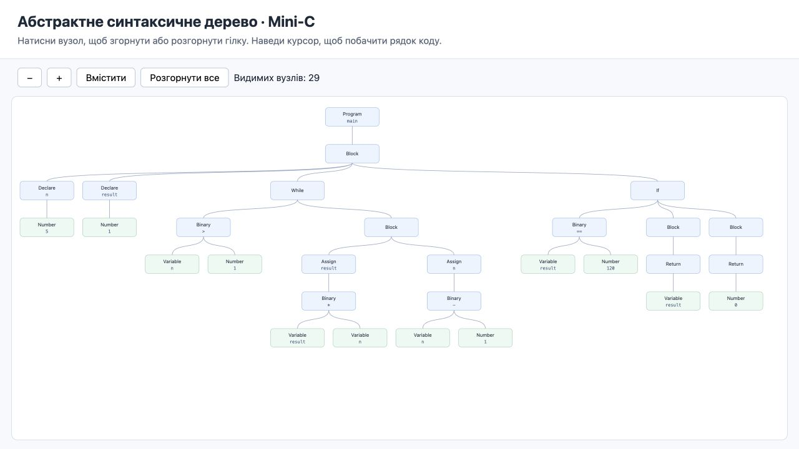

# lab3_SP

Лабораторна №3: синтаксичний аналізатор **підмножини C** на Flex/Bison.

Реалізовано побудову AST, інтерпретатор, трансляцію AST у Python та інтерактивну
візуалізацію дерева у браузері на JavaScript/SVG. HTML працює без мережі та бібліотек.

## Запуск

Потрібні C-компілятор, Make, Flex, Bison і Python 3.10+.
Перевірено на macOS: Apple Clang 21, Flex 2.6.4, Bison 2.3, Python 3.11.

```sh
git clone https://github.com/LoFiSwanL/lab3_SP.git
cd lab3_SP
make
make demo
```

Демонстраційна програма обчислює факторіал 5. Інтерпретатор виводить
`Результат main: 120`, а згенерований Python — `120`.

```sh
# Перевірити лише синтаксис
./build/minic examples/factorial.c

# Виконати AST та згенерувати Python і HTML
./build/minic examples/factorial.c --run --python build/result.py --html build/ast.html
python3 build/result.py

# Відкрити дерево на macOS; на іншій ОС — відкрити цей HTML у браузері
open build/ast.html

# Перевірити обробку помилок
./build/minic examples/syntax_error.c
./build/minic examples/runtime_error.c --run

# Автоматичні перевірки
make test
```

В HTML натискання на вузол згортає/розгортає гілку. Є масштабування, кнопка
«Вмістити» та підказки з номером рядка. Великі дерева можна прокручувати.
Результати й згенеровані файли Bison містяться в `build/`.

Збережений приклад: [Python](results/factorial.py), [HTML із деревом](results/ast.html),
[вивід запуску](results/demo.txt). HTML із GitHub потрібно завантажити й відкрити локально.



## Підтримувана граматика

Одна функція `int main() { ... }` без параметрів. У її тілі:

- оголошення `int x;` і `int x = expression;`, по одній змінній;
- присвоєння `x = expression;`, блоки `{ ... }`, порожній оператор `;`;
- `if (...) statement`, `if (...) statement else statement`, `while (...) statement`;
- `return expression;`;
- цілі десяткові, вісімкові (`010`) та шістнадцяткові (`0x10`) літерали;
- `+ - * / %`, порівняння `< > <= >= == !=`, логічні `&& || !`;
- унарні `+ -`, дужки, коментарі `//` та `/* ... */`.

Основні правила (повна граматика — у `src/parser.y`):

```text
program     -> int main ( ) block
block       -> { statements }
statements  -> empty | statements statement | statements declaration
declaration -> int ID ; | int ID = expression ;
statement   -> block | ; | ID = expression ; | return expression ;
             | if ( expression ) statement
             | if ( expression ) statement else statement
             | while ( expression ) statement
expression  -> NUMBER | ID | ( expression )
             | unary_operator expression
             | expression binary_operator expression
```

Це навчальна підмножина, не повний C-компілятор: немає інших типів, функцій,
масивів, вказівників, `for`, `printf`, препроцесора, `++/--` і складених присвоєнь.
Значення `main` показується самим інтерпретатором; CLI завершується кодом 0
за успіху, 1 за помилки. Досягнення кінця `main` повертає 0.

`int` має діапазон −2147483648…2147483647; окремий додатний літерал — не більше
2147483647. Мінімальне значення можна записати як `-2147483647 - 1`.
Переповнення та ділення на нуль зупиняють виконання. Ділення відкидає дробову
частину до нуля, `%` відповідає такому діленню. `&&` і `||` обчислюються скорочено.
Блоки створюють області видимості; підтримано затінення змінних.

Семантичні помилки змінних перевіряються **під час виконання відповідного вузла**:
немає окремого статичного аналізу недосяжних гілок. Режим без `--run` перевіряє
синтаксис. Для літералів перевірка діапазону також виконується під час генерації Python.
Інтерпретатор і Python мають однаковий захисний ліміт 100000 відвідувань операторів.

## Файли та принцип роботи

```text
текст C -> Flex: токени -> Bison: LALR(1) -> AST
                                            ├─ виконання
                                            ├─ Python-код
                                            └─ JSON -> HTML/JavaScript/SVG
```

| Файл | Призначення |
|---|---|
| `src/lexer.l` | Регулярні вирази, токени, коментарі, лексичні помилки |
| `src/parser.y` | Граматика, пріоритети, семантичні дії для побудови AST |
| `src/ast.h`, `src/ast.c` | Вузли, інтерпретатор, генератори Python і JSON/HTML |
| `src/main.c` | CLI, читання програми та запис результатів |
| `src/runtime.py` | Допоміжний код для C-семантики у згенерованому Python |
| `src/viewer.html` | Відображення AST засобами JavaScript/SVG |
| `src/embed.py` | Вбудовує runtime і переглядач у виконуваний файл під час збірки |
| `tests/test_minic.py` | Позитивні й негативні наскрізні перевірки |

`make` створює `parser.tab.c/.h`, `lexer.c`, звіт `parser.output`, `assets.h`
і компілює їх з власним C-кодом у `build/minic`. Готовий `minic` не потребує
файлів `runtime.py` та `viewer.html` поряд із собою: вони вбудовані.

Тести порівнюють інтерпретатор, згенерований Python та, за наявності `cc`,
виконання тих самих коректних прикладів справжнім C-компілятором. Також
перевіряють діагностику, структуру AST та відсутність нерозв'язаних конфліктів.

Теорія, питання по коду й порядок демонстрації: [DEFENSE.md](DEFENSE.md).

## Відповідність умові

| Пункт | Реалізація |
|---|---|
| Працюючий проєкт на Lex/YACC або аналогу | Flex + Bison, збірка через Make |
| Питання по коду | Пояснення у `DEFENSE.md` |
| Граматика C/C++ | Описана вище підмножина C; повний стандарт C не реалізований |
| LALR, YACC, конфлікти | Теорія у `DEFENSE.md`, стани й розв'язання у `parser.output` |
| Семантика AST | Інтерпретатор із змінними, умовами та циклами |
| Генерація цільового коду | Окрема виконувана Python-програма |
| Візуалізація AST | Інтерактивне дерево у браузері на JavaScript/SVG |
| GitHub і захист | Репозиторій; відео або особистий захист виконується окремо |
